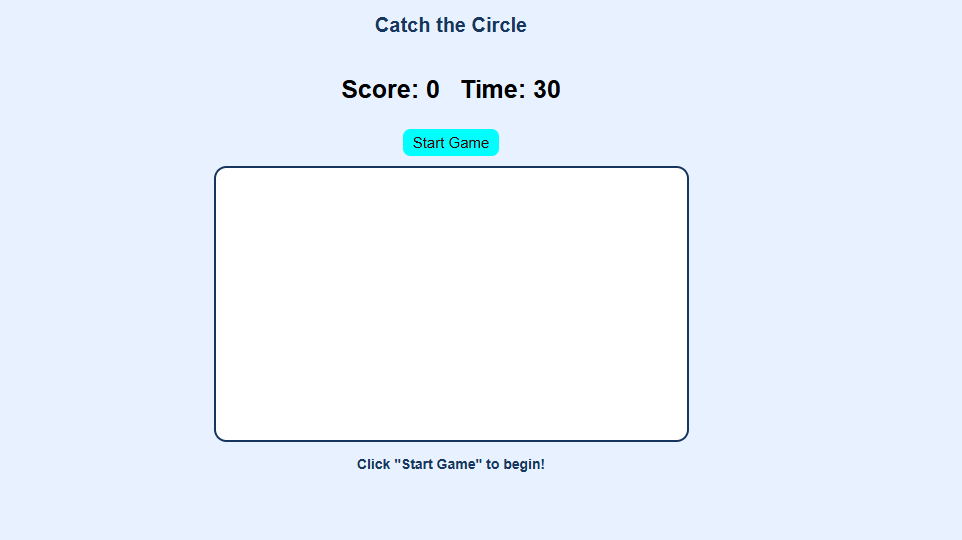
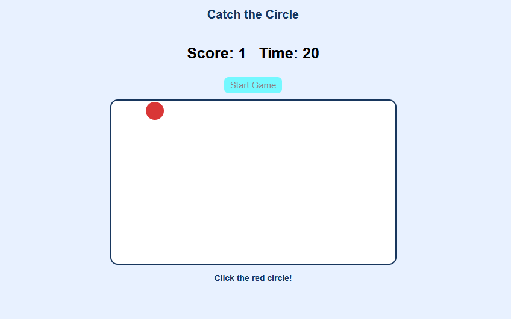
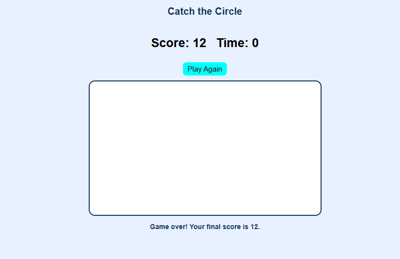

# Catch the Circle

A small browser game: click the red circle as many times as you can in 30 seconds.

**Play it here:** https://ahmed-shaz.github.io/catch-the-circle/

## Screenshots

| Start screen | Playing | Game over |
|---|---|---|
|  |  |  |

## How to play

1. Press **Start Game**.
2. Click the red circle. Every click gives 1 point and the circle jumps to a new place.
3. When the 30 seconds are over, your final score is shown. Press **Play Again** to try for a better score.

## Features

- 30 second timer with a live score
- The circle jumps to a random place after every click
- The layout fits small screens too
- No libraries or installs: plain HTML, CSS and JavaScript

## Project files

| File | What it does |
|---|---|
| `index.html` | The page: score, timer, start button and the game box |
| `style.css` | Colors, layout and the round red target |
| `main.js` | The game code: start, timer, score, moving the circle and game over |

## Run it on my computer

Download the files and open `index.html` in a browser. Nothing needs to be installed.

## Built with

HTML, CSS and JavaScript

## Credits

The idea comes from different tutorials.

Made by Ahmed, 2026
